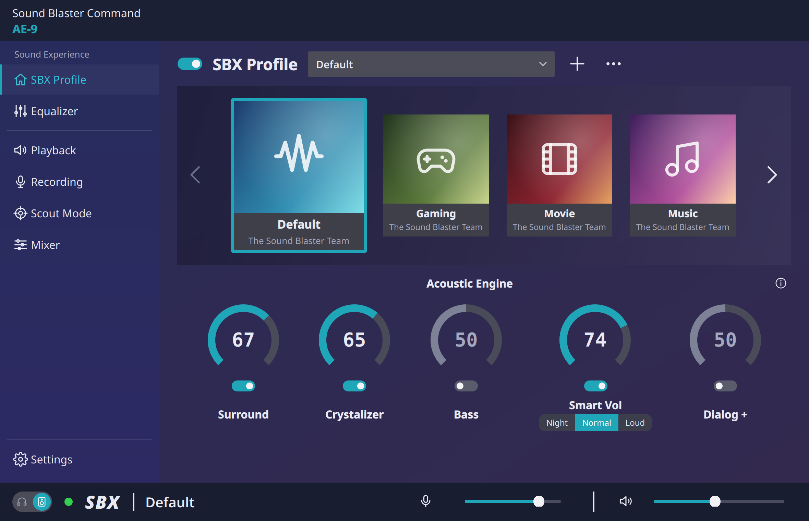
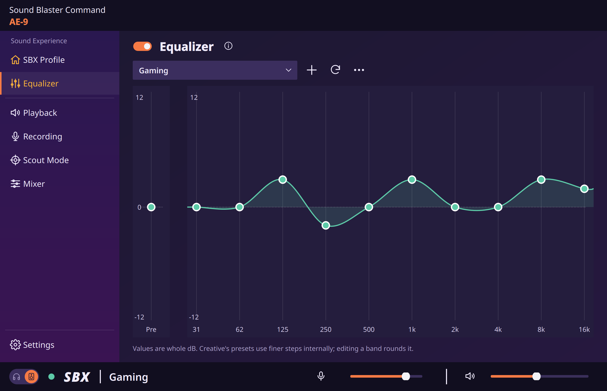
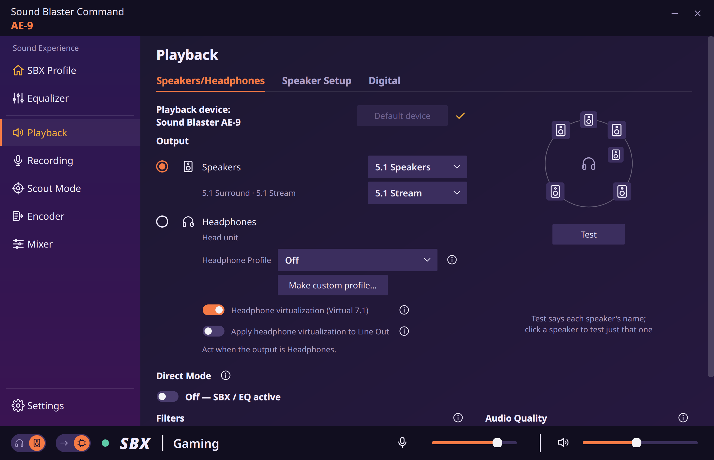
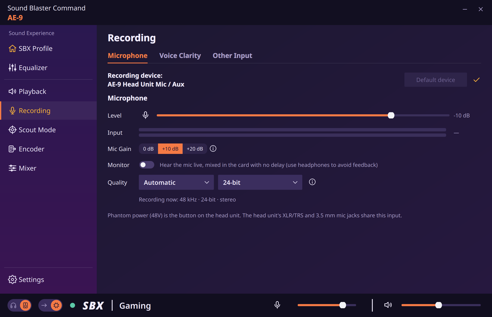
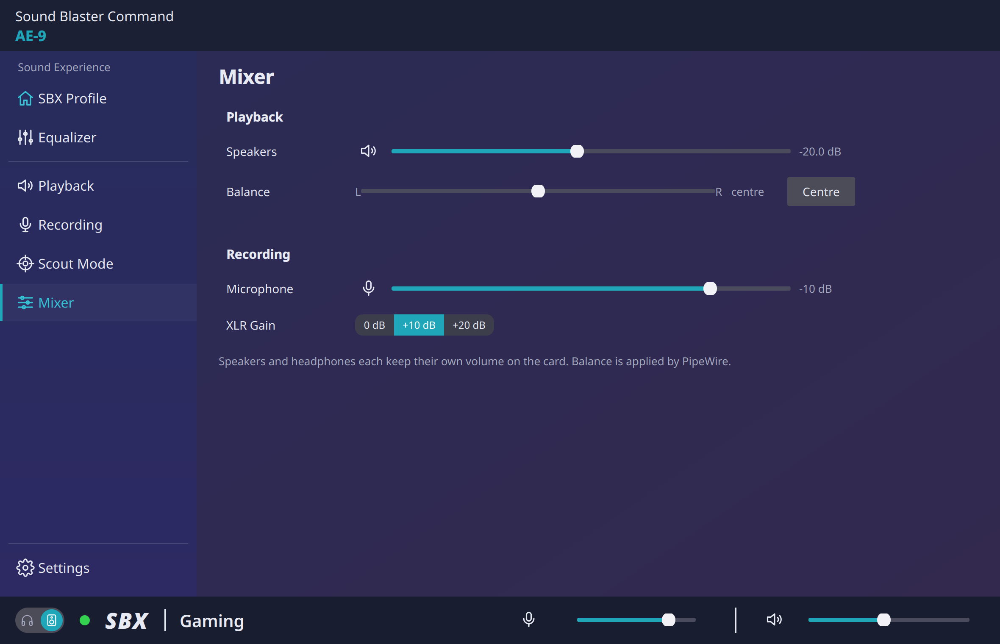
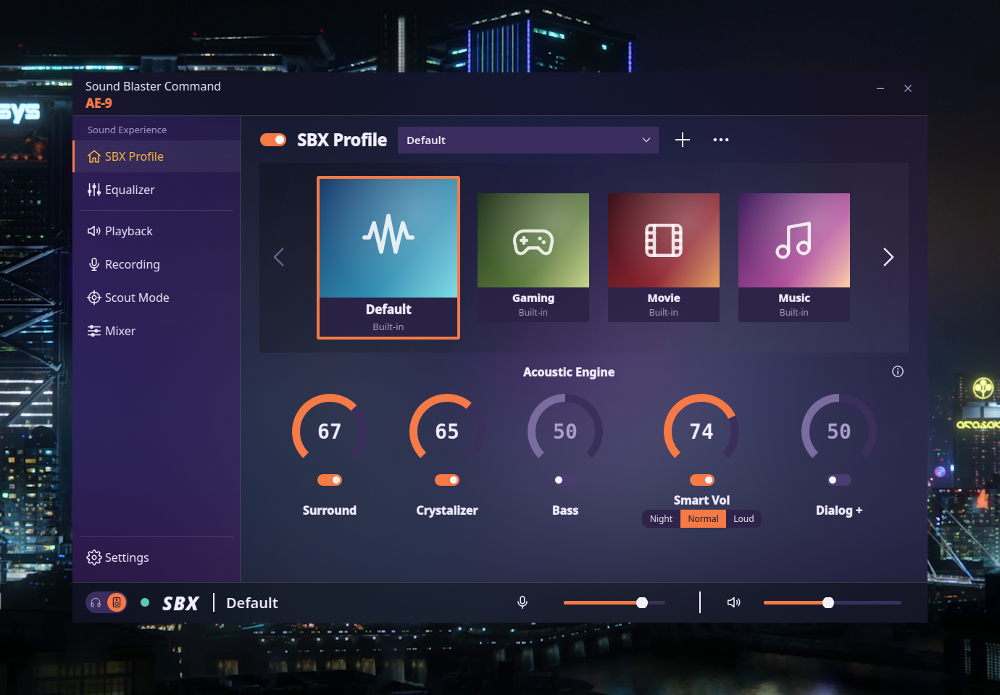
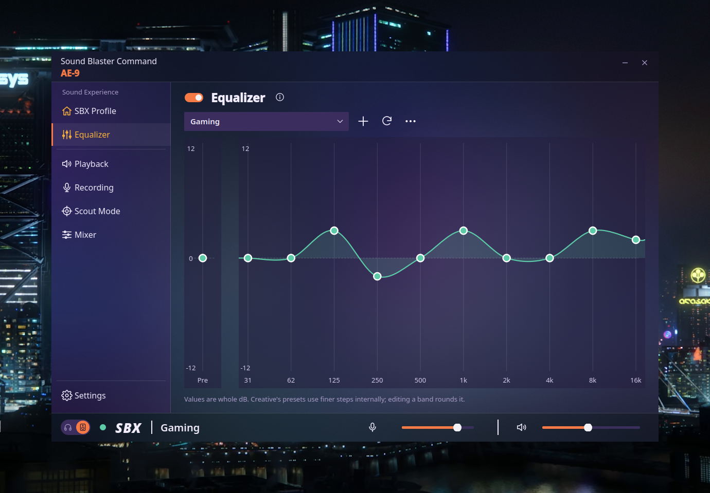

# Sound Blaster Command for Linux (AE-9)



A desktop control panel for the Creative Sound Blaster AE-9, styled after
Creative's *Sound Blaster Command*. This is the UI half of
[SbAe9-Drv](https://github.com/3xHelix/SbAe9-Drv): it drives the card through that
driver (`snd-hda-codec-creative-ae9`, 0.6.x; 0.6.7+ for 5.1, 0.6.8+ for
bit depth, 0.7.0+ for 5.1 at 96 kHz, 0.9.4+ for 44.1/88.2 kHz and 5.1 at
192 kHz) and
works with the normal Linux audio stack: apps play to the AE-9 through
PipeWire as usual. The effects run on the card's own DSP, and this app
switches and adjusts them.

## What it controls

| Page | What it does | How |
|---|---|---|
| **SBX Profile** | SBX on/off; Surround, Crystalizer, Bass, Smart Volume (Night/Normal/Loud), Dialog+; built-in and personal profiles | card DSP (ALSA `SBX Switch`, `FX …`) |
| **Equalizer** | 10-band EQ + pre-gain, Creative's 20 presets, your own saved curves | card DSP (`EQ …`) |
| **Playback** | Speakers / headphones, speaker config (2.0 – 5.1) with matching stereo / 5.1 stream, Direct Mode, DAC filter, sample rate and bit depth, default device, spoken speaker test; Headphone Profile (Creative's EQ curve per headphone model); **Speaker Setup** tab: bass redirect (Speaker Type / crossover, subwoofer boost), level and distance per speaker; **Digital** tab: optical out | ALSA + PipeWire |
| **Recording** | Head unit mic (XLR/TRS or 3.5 mm mic jack): level, mic gain (0/+10/+20 dB), phantom power 48V (asks first), live input meter, mute, "listen to mic", sample rate (48 / 96 kHz), default device; **Other Input** tab: optical in, What U Hear (48 / 96 kHz), head unit rear RCA | ALSA + PipeWire |
| **Scout Mode** | Creative's Scout Mode (footstep EQ + Smart Volume) | card DSP |
| **Mixer** | Output volume (same as the head-unit knob), mute, per-channel levels (Front Left / Right, …), mic level | ALSA + PipeWire |
| **Settings** | **Application** tab: colour palette (Command, Helix, Albino or Wololo), UI scale (70–150%), own title bar or the desktop frame, start at login; **Device** tab: driver/device info, every ALSA control (including inactive ones), reset | ALSA |

## Screenshots

<table>
  <tr>
    <td><br><sub>Equalizer</sub></td>
    <td><br><sub>Playback</sub></td>
  </tr>
  <tr>
    <td><br><sub>Recording</sub></td>
    <td><br><sub>Mixer</sub></td>
  </tr>
</table>

Shown in the Helix palette, on a 5.1 setup. Regenerate them with
`python3 tools/screenshots.py [palette]`.

**Glass** (Settings → Application): frosted, see-through backgrounds on any
palette, here Helix at 70% and 50% over a Cyberpunk 2077 wallpaper.

<table>
  <tr>
    <td><br><sub>SBX Profile, Glass 70%</sub></td>
    <td><br><sub>Equalizer, Glass 50%</sub></td>
  </tr>
</table>

Regenerate them on a KDE desktop with `python3 tools/glass_screenshots.py BACKDROP.png`.

Volume, mute and output changes made with the head-unit knob, `alsamixer` or the
desktop slider show up in the app immediately (it listens to ALSA control events).

**Direct Mode on** = audio goes straight to the DAC at the source's rate
(44.1 to 384 kHz in stereo, 176.4 kHz with driver 0.9.7+; 5.1 at
48/96/192 kHz with driver 0.9.4+, up to
96 kHz with 0.7.0+, 48 kHz before) with no effects. **Direct Mode off** =
audio goes through the DSP at 48 or 96 kHz (48 kHz before driver 0.9.4),
and SBX, the EQ and Scout Mode are heard. The app keeps your effect settings either way, and your chosen sample
rate comes back when Direct Mode is switched on again.

Not available on Linux (yet): Super X-Fi, Dolby Digital Live / DTS encoding,
and 7.1 output. The driver doesn't support these yet.

## Requirements

- The AE-9 driver loaded ([SbAe9-Drv](https://github.com/3xHelix/SbAe9-Drv)), with the "Stereo Output + Stereo
  Input" PipeWire profile.
- For 5.1 (4.0 / 4.1 / 5.1 speakers, the stereo / 5.1 stream switch) and a
  speaker test on every channel: driver
  [v0.6.7](https://github.com/3xHelix/SbAe9-Drv/releases/tag/v0.6.7) or newer
  with its PipeWire profile set installed
  ([setup step 4](https://github.com/3xHelix/SbAe9-Drv#4-pipewire-profiles-stereo-and-51)).
  Older drivers work as before, in stereo.
- For the full sample-rate picker (48–384 kHz out of the box), picking the
  bit depth (24 / 32-bit) and the EQ presets in A–Z order with the game
  presets last: driver
  [v0.6.8](https://github.com/3xHelix/SbAe9-Drv/releases/tag/v0.6.8) or newer
  (it adds the "PCM Bit Depth" control and reorders the presets). With older
  drivers the depth is set by the driver's `pcm_bits` option and shown greyed
  out, and the presets keep the driver's old order.
- For 5.1 at 96 kHz: driver
  [v0.7.0](https://github.com/3xHelix/SbAe9-Drv/releases/tag/v0.7.0) or newer
  (with its `surround_96k` option on, the default). Older drivers play 5.1 at
  48 kHz.
- For 44.1 and 88.2 kHz (stereo, Direct Mode), 5.1 at 192 kHz and 96 kHz
  with Direct Mode off: driver
  [v0.9.4](https://github.com/3xHelix/SbAe9-Drv/releases/tag/v0.9.4) or newer
  (options `pcm_rates=2`, `surround_192k=1` and `dsp_96k=Y`, all the default). With it, switching Direct Mode on while playing no
  longer needs a pause and play.
- For recording at 96 kHz and 32-bit: driver
  [v0.9.1](https://github.com/3xHelix/SbAe9-Drv/releases/tag/v0.9.1) or newer.
- For optical (S/PDIF) out and in: driver
  [v0.8.0](https://github.com/3xHelix/SbAe9-Drv/releases/tag/v0.8.0) or newer.
  Optical in also needs the driver's
  `config/ae9-optical-in.conf` in `~/.config/pipewire/pipewire.conf.d/`.
- For What U Hear: driver
  [v0.9.0](https://github.com/3xHelix/SbAe9-Drv/releases/tag/v0.9.0) or newer, with its
  `config/ae9-what-u-hear.conf` in the same folder.
- From driver [v0.11.0](https://github.com/3xHelix/SbAe9-Drv/releases/tag/v0.11.0) the driver adds optical in, What U Hear and the
  rear RCA input to PipeWire itself (its card profile, installed with its
  packages): the copied `ae9-*.conf` files above aren't needed and make
  each input show up twice, so delete them. It also has seven DAC filters
  under Creative's names (older drivers: Default / Fast / Slow).
- For the head unit's rear RCA input and the subwoofer boost switch: driver
  [v0.10.1](https://github.com/3xHelix/SbAe9-Drv/releases/tag/v0.10.1) or newer, with its
  `config/ae9-rear-rca-in.conf` in the same folder.
- For 176.4 kHz (stereo, Direct Mode): driver
  [v0.9.7](https://github.com/3xHelix/SbAe9-Drv/releases/tag/v0.9.7) or newer
  (`pcm_176k4=Y`).
- For Speaker Setup (bass redirect, speaker levels and distances) and the
  Headphone Profile picker: driver
  [v0.10.0](https://github.com/3xHelix/SbAe9-Drv/releases/tag/v0.10.0) or newer.
  The headphone profiles also need Creative's curves, which the driver's
  `sudo ae9-get-firmware AECMDMasterInstaller_3.4.92.00.exe` installs from
  Creative's Sound Blaster Command installer (the app looks in
  `firmware/creative-ae9/hp` and `firmware/updates/creative-ae9/hp`).
  This release pairs with
  [SbAe9-Drv v0.11.0](https://github.com/3xHelix/SbAe9-Drv/releases/tag/v0.11.0).
- For switching phantom power (48V) from the app and What U Hear at 96 kHz:
  driver [v0.9.5](https://github.com/3xHelix/SbAe9-Drv/releases/tag/v0.9.5)
  or newer (`wuh_96k=Y`, the default).
- For the head unit's plug indicators (3.5 mm headphone and mic jacks), the
  auto switch on headphone plug and the "Mic Gain" control name: driver
  [v0.9.3](https://github.com/3xHelix/SbAe9-Drv/releases/tag/v0.9.3) or newer.
  Older drivers hide the plug features and use their "XLR Gain" control.
- `alsa-utils` for the spoken speaker test (it brings the "Front Left…"
  voice files); without it the test plays a tone.
- Python 3, PySide6 (`sudo dnf install python3-pyside6`), PipeWire tools
  (`pw-dump`, `wpctl`, `pw-metadata`, `pw-play`, `pw-record`, `pw-loopback`),
  and `libasound`. All of these come with Fedora's standard desktop install.

## Panel widget (KDE Plasma 6) and top bar extension (GNOME)

`install.sh` also installs a panel widget, **Sound Blaster AE-9**: right-click
the panel > Add Widgets. It shows the running rate on the panel. Its popup has
DSP / Direct Mode, SBX (with Direct Mode off, as in the app), sample rate, bit
depth, PipeWire quantum (with the latency) and phantom power 48V (after a
warning). It works through `sbae9-sbc ctl`, the app's command line, so it
follows the same rules; the app doesn't need to be open. Its settings
(right-click > Configure) pick the sample rates and quantum values it lists
and an optional quick preset button.

Keyboard shortcuts (KDE): Toggle Direct Mode / DSP, Toggle Speakers /
Headphones and Toggle SBX, with no keys set. Set them in System Settings >
Keyboard > Shortcuts > Sound Blaster Command.

On GNOME (45 to 50), `install.sh` installs the same thing as a Shell
extension, **Sound Blaster AE-9** in the top bar: turn it on in the Extensions
app after logging out and back in, or with
`gnome-extensions enable sbae9-sbc@3xhelix.github.io`. Its preferences (the
Extensions app, or `gnome-extensions prefs sbae9-sbc@3xhelix.github.io`) have
the same lists and quick preset, and the keyboard shortcuts.

## Run / install

```sh
./sbae9-sbc            # run from this folder
./install.sh           # installs a copy: menu entry, app icon, ~/.local/bin/sbae9-sbc
./sbae9-sbc --palette helix   # one launch in the Helix palette (saved choice unchanged)
./sbae9-sbc --scale 80        # one launch at 80% size (saved UI scale unchanged)
```

`install.sh` copies the app to `~/.local/share/sbae9-sbc` (like SbAe9-AudioMon
does), so the menu app is always the build you last installed, never a
half-edited working tree. Re-run it after each tested change.

## Tests

```sh
python3 -m unittest discover -s tests
```

About 90 tests, a few seconds, no card needed. They run against a fake AE-9
(control shapes copied from a real card on driver 0.6.8) and a fake
PipeWire, with settings in a temp folder: nothing touches your card, your
PipeWire or `~/.config`. They cover the rate rules (caps, quantum, hands off
what others set), the stereo / 5.1 profile sync, "Applying changes…", the
EQ preset list, per-channel volume and the speaker test.

## Files it writes

- `~/.config/sbae9-sbc/settings.json` — your profiles, EQ presets, last page.
- `~/.config/pipewire/pipewire.conf.d/90-sbae9-sbc-rates.conf` — only if you
  pick an *Audio Quality* setting (PipeWire's allowed/forced sample rate).
  Delete it to go back to PipeWire's defaults.
- `~/.config/wireplumber/wireplumber.conf.d/91-sbae9-sbc-mic.conf` — only
  if you pick a mic sample rate (Recording → Microphone). Automatic removes
  it.
- `~/.config/autostart/sbae9-sbc.desktop` — only while "Start Sound Blaster
  Command when you log in" is on.

## Layout

```
sbcommand/
  alsa.py       the ALSA mixer binding (from sbae9kit.mixer)
  card.py       the AE-9 as a Qt object: named controls, volume curves, profiles
  pipewire.py   nodes, default device, rates, test tone, mic monitor, level meter
  profiles.py   built-in SBX profiles and the driver's EQ preset tables
  pages.py      one class per page
  widgets.py    dial, toggle switch, EQ graph, profile carousel, meters
  window.py     sidebar, page stack, bottom bar
  theme.py      the active palette + Qt style sheet
sbae9kit/       the shared kit (see below); don't edit here
appicon/        the app icon, 16-512 px
tools/          README screenshots (plain and Glass)
```

### The shared kit

Sound Blaster Command and SbAe9-AudioMon (the AE-9's level meters) are built
on one base, **SbAe9-Kit**: the palettes, Glass, UI scale and XWayland
handling, the frameless window parts, AE-9 detection, the ALSA binding and
the icon tool. `sbae9kit/` is a vendored copy of it, written by SbAe9-Kit's
`tools/sync_kit.py`; a test fails if it's edited here instead. Both apps also
share their conventions: copy-install, `~/.config/<app>/`, the same options,
tests and release format.

## Related tools

- [Helvum](https://gitlab.freedesktop.org/pipewire/helvum): a patchbay for
  PipeWire (`sudo dnf install helvum`). It draws every app, device and port
  and the links between them, which makes it easy to see where audio is
  going, e.g. that a 5.1 stream really reaches all six of the AE-9's
  channels. A good companion to this app.

## License

GPL-2.0-only, same as the driver. See [LICENSE](LICENSE).

## Disclaimer

Not affiliated with Creative. "Sound Blaster", "SBX" and related names are
Creative Technology's trademarks; the look is a nod to their app, with no
Creative code or artwork included.
