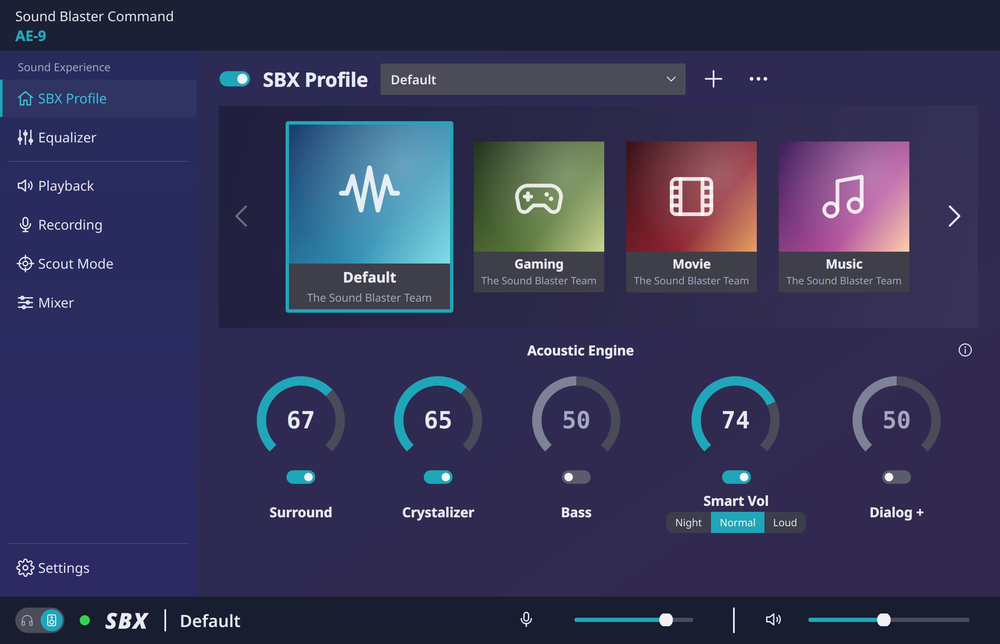
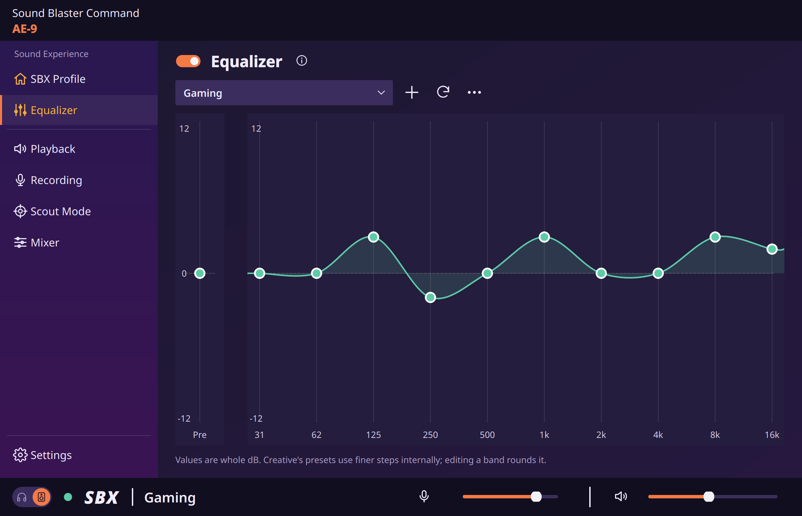
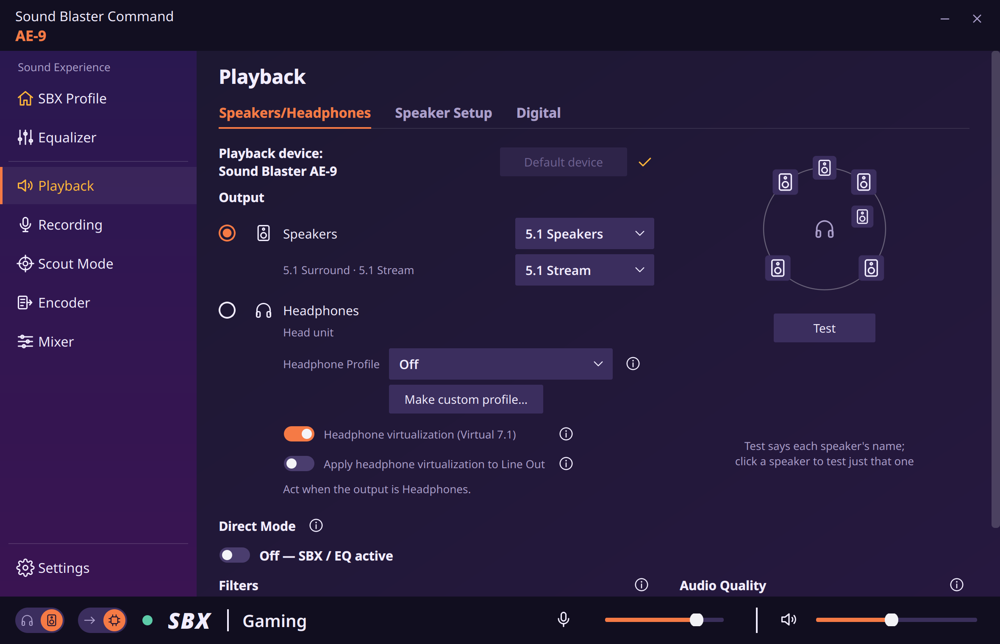
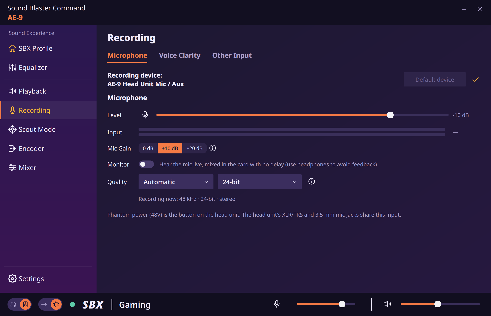
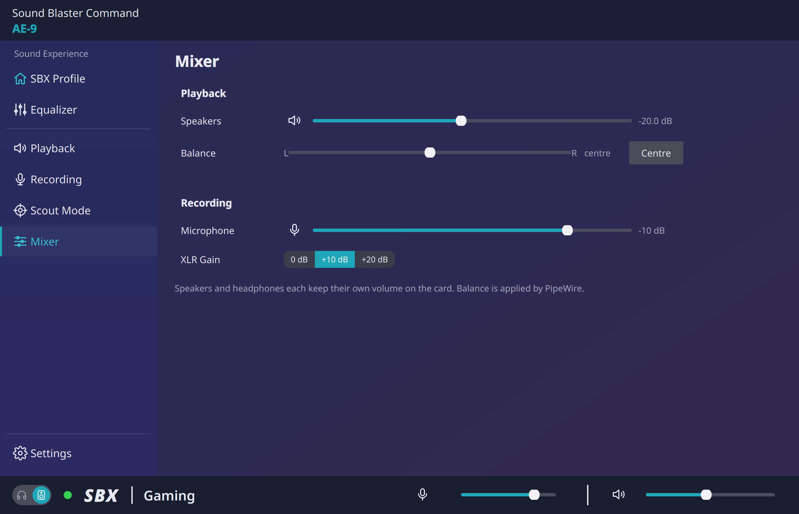
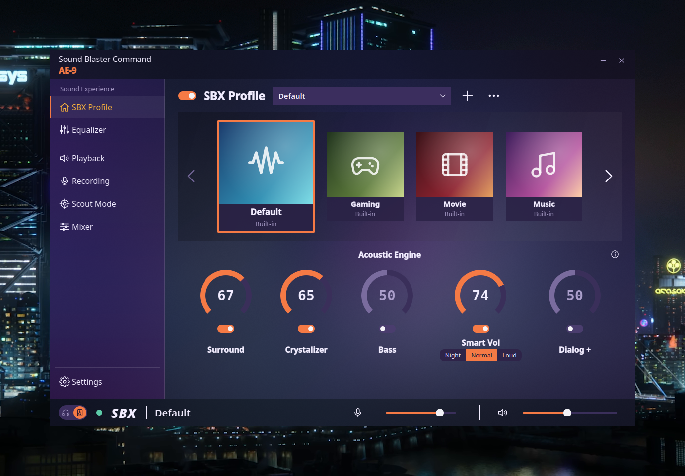
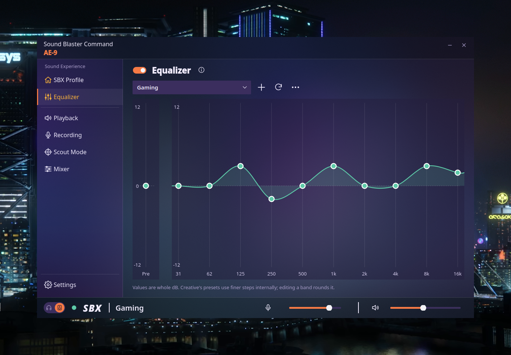

# Sound Blaster Command for Linux (AE-9)



A desktop control panel for the **Creative Sound Blaster AE-9**, styled after
Creative's *Sound Blaster Command* for Windows.

It's the companion app to the AE-9 Linux driver,
[SbAe9-Drv](https://github.com/3xHelix/SbAe9-Drv). Your apps keep playing
through PipeWire as usual. The effects run on the card's own DSP, and this app
switches and tunes them.

This release pairs with
[SbAe9-Drv v0.12.13](https://github.com/3xHelix/SbAe9-Drv/releases/tag/v0.12.13).

---

## Highlights

- **SBX effects and a 10-band EQ**: Surround, Crystalizer, Bass, Smart Volume
  and Dialog+, with Creative's presets and profiles plus your own.
- **Speakers and headphones**: 2.0 to 5.1 speaker setups, bass redirect,
  per-speaker level and distance, headphone profiles and Virtual 7.1.
- **Sample rate and bit depth**: 44.1 to 384 kHz, 24 or 32-bit, and Direct
  Mode for bit-perfect playback.
- **Microphone**: gain, phantom power (always asks first), live meter, mic
  monitor, Voice Clarity and Voice Morph.
- **Optical out and in**, What U Hear, and an encoder that sends your 5.1 mix
  to a receiver over optical (encoded on your PC by your own ffmpeg).
- **Stays in sync**: changes made with the head unit's knob, `alsamixer` or
  the desktop volume slider show up in the app immediately.
- **Panel widget** for KDE Plasma and a **top bar extension** for GNOME.
- Four colour palettes, a frosted **Glass** look, and UI scaling.

---

## Install

The app is plain Python and installs the same way on every distro. Only the
package names in step 2 differ.

**1. Install the AE-9 driver.** Follow
[SbAe9-Drv's install steps](https://github.com/3xHelix/SbAe9-Drv) for your
distro. The latest release is best; see [Driver versions](#driver-versions).

**2. Install what the app needs.** Pick your distro *(💡 most desktops
already have everything except PySide6, so this often installs just that)*:

| Distro | Command |
|---|---|
| **Fedora** | `sudo dnf install python3-pyside6 pipewire-utils wireplumber alsa-utils pulseaudio-utils libnotify` |
| **Ubuntu 26.04+, Debian 13+** | `sudo apt install python3-pyside6.qtwidgets python3-pyside6.qtsvg pipewire-bin wireplumber alsa-utils pulseaudio-utils libnotify-bin` |
| **Arch, Manjaro, EndeavourOS** | `sudo pacman -S pyside6 pipewire pipewire-audio wireplumber alsa-utils libpulse libnotify` |
| **openSUSE Tumbleweed** | `sudo zypper install python313-pyside6 pipewire-tools wireplumber alsa-utils pulseaudio-utils libnotify-tools` |

<details>
<summary>Ubuntu 24.04, Linux Mint 22 and other distros without a PySide6 package</summary>

Install the other packages from the Ubuntu row above, leaving out the two
`python3-pyside6` ones, then install PySide6 for your user with pip:

```sh
sudo apt install python3-pip
pip install --user --break-system-packages PySide6
```

`--break-system-packages` only means pip installs into your home folder
(`~/.local`) next to the system's Python packages. It doesn't touch the
system's own files.

</details>

**Optional:** for the Encoder page (sending your mix over optical as AC-3 or
DTS), also install `ffmpeg` from your distro. Fedora users get the full
`ffmpeg` from [RPM Fusion](https://rpmfusion.org/).

**3. Download and install the app.** Grab the `.tar.gz` from the
[latest release](https://github.com/3xHelix/SbAe9-SBC/releases/latest), or
clone it:

```sh
git clone https://github.com/3xHelix/SbAe9-SBC.git
cd SbAe9-SBC
./install.sh
```

You don't need `sudo`: everything installs in your home folder. You get a
menu entry, the app icon, `~/.local/bin/sbae9-sbc`, and the panel widget on
KDE or the top bar extension on GNOME. To update, pull or download the new
release and run `./install.sh` again.

You can also run it straight from the source folder:

```sh
./sbae9-sbc                   # run from the source folder
./sbae9-sbc --palette helix   # one launch in another palette
./sbae9-sbc --scale 80        # one launch at 80% size
```

`install.sh` copies the app to `~/.local/share/sbae9-sbc`, so the menu entry
always runs the version you last installed, not a half-edited source folder.

---

## What's in the app

| Page | What you can do |
|---|---|
| **SBX Profile** | Turn SBX on or off; set Surround, Crystalizer, Bass, Smart Volume (Night / Normal / Loud) and Dialog+; pick a built-in profile or save your own. |
| **Equalizer** | 10-band EQ with pre-gain, Creative's 20 presets, and your own saved curves. |
| **Playback** | Speakers or headphones, speaker setup (2.0 to 5.1), Direct Mode, DAC filter, sample rate and bit depth, default device, and a spoken speaker test. Headphone Profile and Virtual 7.1.<br>**Speaker Setup** tab: bass redirect and each speaker's level and distance.<br>**Digital** tab: what optical out plays. |
| **Recording** | Head unit mic: level, gain, phantom power (48V), live meter, mute, listen-to-mic, sample rate.<br>**Voice Clarity** tab: echo cancellation, noise reduction, Mic EQ, Voice Morph.<br>**Other Input** tab: optical in, What U Hear, rear RCA input. |
| **Scout Mode** | Creative's Scout Mode (footstep EQ with Smart Volume). |
| **Encoder** | Send the card's mix over optical as AC-3 or DTS (experimental), encoded on your PC by your ffmpeg. |
| **Mixer** | Output volume (the same as the head unit's knob), mute, per-channel levels, mic level. |
| **Settings** | Palette, UI scale, Glass, title bar style, start at login. The **Device** tab shows driver info and every ALSA control. |

### Direct Mode, in short

- **Direct Mode on**: audio goes straight to the DAC at the source's own rate
  (up to 384 kHz in stereo), with no effects.
- **Direct Mode off (DSP mode)**: audio goes through the card's DSP at 48 or
  96 kHz, so SBX, the EQ and Scout Mode are heard.

The app remembers your effect settings either way. Your chosen sample rate
comes back when you switch Direct Mode on again.

Not available on Linux yet: Super X-Fi and 7.1 output.

---

## Screenshots

<table>
  <tr>
    <td><br><sub>Equalizer</sub></td>
    <td><br><sub>Playback</sub></td>
  </tr>
  <tr>
    <td><br><sub>Recording</sub></td>
    <td><br><sub>Mixer</sub></td>
  </tr>
</table>

Shown in the Helix palette on a 5.1 setup.

**Glass** (Settings → Application) gives any palette a frosted, see-through
background. Here it's Helix at 70% and 50%:

<table>
  <tr>
    <td><br><sub>SBX Profile, Glass 70%</sub></td>
    <td><br><sub>Equalizer, Glass 50%</sub></td>
  </tr>
</table>

---

## Panel widget and top bar extension

`install.sh` also adds quick controls to your desktop, so you don't need the
app open for everyday switching:

- DSP / Direct Mode and SBX
- sample rate, bit depth and PipeWire quantum (with the latency)
- phantom power 48V (after a warning)
- the current sample rate, shown on the panel

**KDE Plasma 6:** right-click the panel → *Add Widgets* → **Sound Blaster
AE-9**. Right-click it → *Configure* to choose which rates and quantum values
it lists, and to add a quick preset button.

**GNOME 45 to 50:** log out and back in, then turn on **Sound Blaster AE-9**
in the Extensions app, or run:

```sh
gnome-extensions enable sbae9-sbc@3xhelix.github.io
```

Its preferences have the same options.

**Keyboard shortcuts:** *Toggle Direct Mode / DSP*, *Toggle Speakers /
Headphones* and *Toggle SBX*. They're there but have no keys yet. Set them in
System Settings → Keyboard → Shortcuts → Sound Blaster Command on KDE, or in
the extension's preferences on GNOME.

---

## Driver versions

The app works with older drivers and hides or greys out what they can't do.
For everything, use the latest
[SbAe9-Drv release](https://github.com/3xHelix/SbAe9-Drv/releases).

<details>
<summary>Which driver version each feature needs</summary>

| Feature | Driver |
|---|---|
| Basic control (SBX, EQ, volume, Direct Mode) | 0.6.x |
| 5.1 speakers and the stereo / 5.1 switch (with the driver's [PipeWire profiles](https://github.com/3xHelix/SbAe9-Drv#4-pipewire-profiles-stereo-and-51)) | [0.6.7](https://github.com/3xHelix/SbAe9-Drv/releases/tag/v0.6.7) |
| Full sample-rate picker, 24 / 32-bit, EQ presets in A–Z order | [0.6.8](https://github.com/3xHelix/SbAe9-Drv/releases/tag/v0.6.8) |
| 5.1 at 96 kHz | [0.7.0](https://github.com/3xHelix/SbAe9-Drv/releases/tag/v0.7.0) |
| Optical out and in | [0.8.0](https://github.com/3xHelix/SbAe9-Drv/releases/tag/v0.8.0) |
| What U Hear | [0.9.0](https://github.com/3xHelix/SbAe9-Drv/releases/tag/v0.9.0) |
| Recording at 96 kHz and 32-bit | [0.9.1](https://github.com/3xHelix/SbAe9-Drv/releases/tag/v0.9.1) |
| Head unit plug indicators and auto switch on headphone plug | [0.9.3](https://github.com/3xHelix/SbAe9-Drv/releases/tag/v0.9.3) |
| 44.1 / 88.2 kHz, 5.1 at 192 kHz, DSP mode at 96 kHz | [0.9.4](https://github.com/3xHelix/SbAe9-Drv/releases/tag/v0.9.4) |
| Phantom power from the app, What U Hear at 96 kHz | [0.9.5](https://github.com/3xHelix/SbAe9-Drv/releases/tag/v0.9.5) |
| 176.4 kHz | [0.9.7](https://github.com/3xHelix/SbAe9-Drv/releases/tag/v0.9.7) |
| Speaker Setup and Headphone Profile | [0.10.0](https://github.com/3xHelix/SbAe9-Drv/releases/tag/v0.10.0) |
| Rear RCA input, subwoofer boost | [0.10.1](https://github.com/3xHelix/SbAe9-Drv/releases/tag/v0.10.1) |
| Inputs set up in PipeWire by the driver, Creative's seven DAC filters | [0.11.1](https://github.com/3xHelix/SbAe9-Drv/releases/tag/v0.11.1) |
| Optical out as its own output, passthrough status | [0.12.0](https://github.com/3xHelix/SbAe9-Drv/releases/tag/v0.12.0) |
| Optical mirror switch, 5.1 from the Encoder page | [0.12.1](https://github.com/3xHelix/SbAe9-Drv/releases/tag/v0.12.1) |
| Voice Clarity, Voice Morph, the card's mic monitor, Virtual 7.1, custom headphone profiles | [0.12.2](https://github.com/3xHelix/SbAe9-Drv/releases/tag/v0.12.2) |
| Recovery when the card stops answering, `ae9-reload` | [0.12.9](https://github.com/3xHelix/SbAe9-Drv/releases/tag/v0.12.9) |
| Headphone profiles load while audio plays | [0.12.10](https://github.com/3xHelix/SbAe9-Drv/releases/tag/v0.12.10) |
| DSP mode at the same level as Direct Mode | [0.12.11](https://github.com/3xHelix/SbAe9-Drv/releases/tag/v0.12.11) |

</details>

**Upgrading from driver 0.10.x?** From 0.11 the driver sets up optical in,
What U Hear and the rear RCA input in PipeWire itself. Delete any old
`ae9-*.conf` files you copied into `~/.config/pipewire/pipewire.conf.d/`,
or each input shows up twice.

**Headphone profiles** also need Creative's EQ curves. The driver's tool
installs them from Creative's Windows installer:

```sh
sudo ae9-get-firmware AECMDMasterInstaller_3.4.92.00.exe
```

---

## Files it writes

| File | When |
|---|---|
| `~/.config/sbae9-sbc/settings.json` | Always: your profiles, EQ presets, last page. |
| `~/.config/pipewire/pipewire.conf.d/90-sbae9-sbc-rates.conf` | Only if you pick a sample rate. Delete it to go back to PipeWire's defaults. |
| `~/.config/wireplumber/wireplumber.conf.d/91-sbae9-sbc-mic.conf` | Only if you pick a mic sample rate. Choosing *Automatic* removes it. |
| `~/.config/autostart/sbae9-sbc.desktop` | Only while "Start at login" is on. |

---

## For developers

### Tests

```sh
python3 -m unittest discover -s tests
```

About 300 tests, done in under half a minute, no card needed. They run
against a fake AE-9 and a fake PipeWire with settings in a temp folder, so
nothing touches your card, your PipeWire or `~/.config`.

### Layout

```
sbcommand/
  alsa.py       the ALSA mixer binding (from sbae9kit.mixer)
  card.py       the AE-9 as a Qt object: named controls, volume curves, profiles
  pipewire.py   nodes, default device, rates, test tone, mic monitor, level meter
  profiles.py   built-in SBX profiles and the driver's EQ preset tables
  pages.py      one class per page
  widgets.py    dial, toggle switch, EQ graph, profile carousel, meters
  window.py     sidebar, page stack, bottom bar
  theme.py      the active palette + Qt style sheet
sbae9kit/       the shared kit (don't edit here, see below)
appicon/        the app icon, 16-512 px
tools/          README screenshot scripts
```

### The shared kit

Sound Blaster Command and SbAe9-AudioMon (the AE-9's level meters) share one
base, **SbAe9-Kit**: palettes, Glass, UI scale, the frameless window, AE-9
detection, the ALSA binding and the icon tool. `sbae9kit/` is a copy written
by SbAe9-Kit's `tools/sync_kit.py`. A test fails if it's edited here
instead.

### Screenshots

```sh
python3 tools/screenshots.py [palette]               # the plain ones
python3 tools/glass_screenshots.py BACKDROP.png      # Glass, on a KDE desktop
```

---

## Related tools

- [Helvum](https://gitlab.freedesktop.org/pipewire/helvum), a PipeWire
  patchbay (`sudo dnf install helvum`). It draws every app, device and link,
  so you can see where your audio is going: for example, that a 5.1 stream
  really reaches all six of the AE-9's channels.

## License

GPL-2.0-only, same as the driver. See [LICENSE](LICENSE).

## Disclaimer

Not affiliated with Creative. "Sound Blaster", "SBX" and related names are
Creative Technology's trademarks. The look is a nod to their app; no Creative
code or artwork is included.
